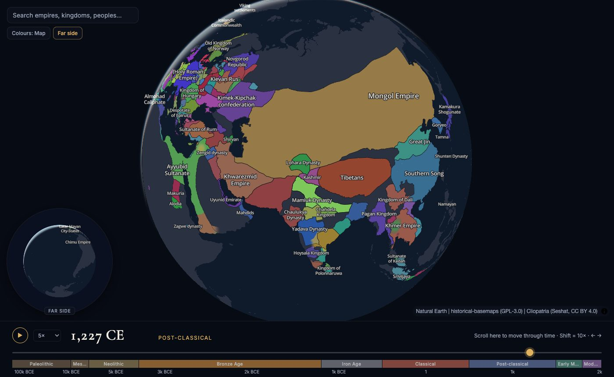

# Time Globe

**Spin the Earth and scroll through 125,000 years of human history.**

Time Globe is a 3D globe with a time slider. As you move through time, empires, kingdoms and cultures
grow, shrink, split and disappear across the map. Watch the Mongols spread out of the steppe, Rome rise
and fracture, or the map of Europe redraw itself in the 1800s, one year at a time.

**Try it: [shumakriss.github.io/time-globe](https://shumakriss.github.io/time-globe/)**



## Highlights

- **Nearly 1,600 polities, year by year.** Borders come from [Cliopatria](https://github.com/Seshat-Global-History-Databank/cliopatria),
  a scholarly dataset of historical states from 3400 BCE to 2024, with prehistoric cultures back to
  123,000 BCE from [historical-basemaps](https://github.com/aourednik/historical-basemaps).
- **Smooth, living borders.** Territory doesn't just blink between dates. Conquests spread out from
  the old frontier, losses recede, and land changing hands is swept over by the new owner's colour.
  New powers grow out of their heartland. Documented border lines still snap to their recorded years,
  so you always know what's real.
- **Scroll through time.** Use the mouse wheel over the timeline, drag the slider, or press play
  (½× to 100×). Era bands give you a sense of where you are.
- **Find anything.** Search for a polity and the globe flies there. If it didn't exist in the year
  you're looking at, time jumps to when it did.
- **See both sides at once.** Turn on the far-side globe to keep an eye on the other hemisphere.
- **Two looks.** *Map* colours give every polity a distinct hue. *Pretty* colours use one soft,
  coordinated palette.
- **Learn more.** Click any territory for its dates and a Wikipedia summary.

## Quick start

You need [Node.js](https://nodejs.org/) 20 or newer and `unzip` (preinstalled on macOS and most Linux).

```sh
git clone <this repo> time-globe
cd time-globe
npm run setup   # npm install + download and build the map data (one time, ~2 minutes)
npm run dev     # open the URL it prints (usually http://localhost:5173)
```

### About the data download

The map data **isn't in the repository**. It's downloaded from its original open sources and processed
on your machine. `npm run setup` does this for you. To run that step on its own:

```sh
npm run data
```

| What happens | Size |
|---|---|
| Downloads source data into `data-raw/` | ~50 MB download |
| Unzips and processes it | ~310 MB in `data-raw/` |
| Builds the files the app loads into `public/data/` | ~40 MB (~9 MB gzipped over the network) |

It takes about 2 minutes and a few GB of RAM. Both folders are git-ignored, and existing downloads are
skipped. You can delete `data-raw/` after a build if you don't plan to rebuild. Running
`npm run dev` without the data prints a reminder instead of starting a blank app.

| Source | Coverage | License |
|---|---|---|
| [Cliopatria](https://github.com/Seshat-Global-History-Databank/cliopatria) (Seshat Global History Databank) | ~1,600 polities, year-level borders, 3400 BCE–2024 | CC BY 4.0 |
| [historical-basemaps](https://github.com/aourednik/historical-basemaps) (A. Ourednik) | Prehistoric cultures, 5 snapshots before 3400 BCE | GPL-3.0 |
| [Natural Earth](https://www.naturalearthdata.com/) | Land outlines | Public domain |
| [Wikipedia](https://en.wikipedia.org/) | Summaries in the info panel, fetched live | CC BY-SA |

## Controls

| Action | How |
|---|---|
| Rotate / zoom the globe | Drag / scroll over the globe |
| Move through time | Scroll over the timeline (Shift = 10×), drag the slider, or ← → |
| Play / pause | Space or ▶, speed menu next to it |
| Jump to an era | Click an era band |
| Search | Click the search box or press `/` |
| Details | Click a territory (Esc closes) |
| Flip to the far side | Click the small globe |

The URL remembers the year (for example `#y=-500`), so you can share a moment in history.

## Commands

| Command | What it does |
|---|---|
| `npm run setup` | Install dependencies and fetch and build the data |
| `npm run dev` | Development server |
| `npm run build` / `npm run preview` | Production build into `dist/` (includes the data) / serve it |
| `npm test` | Unit tests |
| `npm run data` | Fetch and build the data (`data:fetch` and `data:build` run each half) |

## How it works

- **Rendering:** [MapLibre GL](https://maplibre.org/) in globe projection. Borders and labels are
  regular MapLibre layers that show the records for the current year.
- **Fills:** territory fills are a custom WebGL layer (`src/fills/`). A web worker triangulates each
  time window and stores, per vertex, how far it is from the relevant border. The shader animates
  every growth front from a single "year" value, so scrubbing and playback cost almost nothing per
  frame.
- **Data build** (`scripts/build-data.ts`):
  - Simplifies the records (to ~2 km).
  - Works out the animated pieces for each change (`scripts/lib/pieces.ts`): land kept, lost, gained,
    or yielded to a neighbour, plus births and deaths.
  - Assigns the pretty-palette colours.
  - Packs everything as TopoJSON, so shared borders are stored once.

More detail for contributors is in [CLAUDE.md](CLAUDE.md).

## Deployment

Every push to `main` deploys to GitHub Pages through `.github/workflows/deploy.yml`. The workflow
downloads and builds the data, runs the tests, builds the site and publishes `dist/`. Raw downloads
are cached between runs. The data sources are pinned to upstream commits in `scripts/fetch-data.ts`,
so the published data only changes when you update those pins. You can also start a deploy by hand
from the Actions tab ("Run workflow").

## Credits

Time Globe is built on the work of these projects and people.

**Data**

| Source | Used for | License |
|---|---|---|
| [Cliopatria](https://github.com/Seshat-Global-History-Databank/cliopatria) by the [Seshat Global History Databank](https://seshat-db.com/) | Polity borders, 3400 BCE–2024 | CC BY 4.0 |
| [historical-basemaps](https://github.com/aourednik/historical-basemaps) by André Ourednik | Prehistoric cultures before 3400 BCE | GPL-3.0 |
| [Natural Earth](https://www.naturalearthdata.com/) | Land outlines | Public domain |
| [Wikipedia](https://en.wikipedia.org/) via the [Wikimedia REST API](https://en.wikipedia.org/api/rest_v1/) | Summaries and images in the info panel | Text CC BY-SA 4.0; images vary |

**Software**

| Project | Used for | License |
|---|---|---|
| [MapLibre GL JS](https://maplibre.org/) | Globe rendering, borders and labels | BSD-3-Clause |
| [MapLibre demo tiles](https://github.com/maplibre/demotiles) | Label glyphs (Open Sans) | Open Sans: OFL / Apache-2.0 |
| [mapshaper](https://github.com/mbloch/mapshaper) | Geometry processing in the data build | MPL-2.0 |
| [TopoJSON](https://github.com/topojson/topojson-client) | Compact shared-border data format | ISC |
| [earcut](https://github.com/mapbox/earcut) | Polygon triangulation for the fill layer | ISC |
| [polylabel](https://github.com/mapbox/polylabel) | Label placement | ISC |
| [kdbush](https://github.com/mourner/kdbush) / [geokdbush](https://github.com/mourner/geokdbush) | Spatial indexing | ISC |
| [Vite](https://vite.dev/), [TypeScript](https://www.typescriptlang.org/), [Vitest](https://vitest.dev/) | Build, language and tests | MIT / Apache-2.0 / MIT |

**Fonts:** [Cormorant Garamond](https://fonts.google.com/specimen/Cormorant+Garamond) and
[Inter](https://fonts.google.com/specimen/Inter) from Google Fonts (SIL Open Font License).

**Hosting:** [GitHub Pages](https://pages.github.com/).

## Caveats

Historical borders are approximations, and the dataset is uneven. Well-documented states are mapped
in detail. Nomadic and tribal peoples are often missing, which can leave regions grey (the Mongolian
steppe before 1206, for instance). The animations between documented years are for visual effect and
aren't historical claims.
